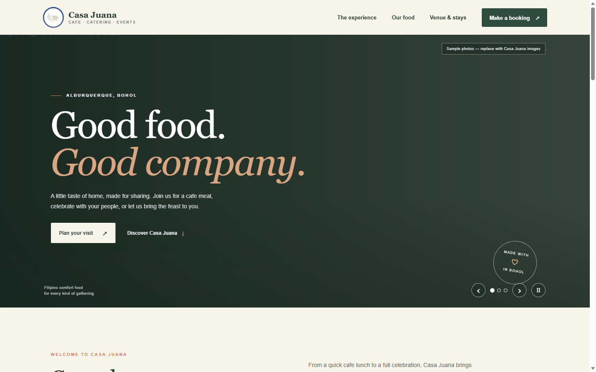

# Casa Juana Cafe

A responsive website for Casa Juana Cafe in Alburquerque, Bohol. Visitors can explore the cafe, catering, events, pool day-use, and overnight stays, then send a booking inquiry.



*Desktop view of the landing page. The page currently uses sample photos hosted outside this repository; images may not appear when viewing the site offline.*

## Run the website

Open `index.html` in a browser for the static site. Its booking form prepares a WhatsApp message; the visitor must send that message in WhatsApp.

To run the website with the PHP booking backend, use PHP 8.2+ with `pdo_sqlite` enabled. From the repository root:

```powershell
php -S 127.0.0.1:8000 -t backend/public backend/public/router.php
```

Open <http://127.0.0.1:8000>. The PHP-served page connects the booking form to `/api/bookings` and stores requests in a private SQLite database. Requests remain pending until the cafe confirms them.

## Staff dashboard

Create an owner account once:

```powershell
.\backend\bin\setup-admin.ps1
```

With the PHP server running, open <http://127.0.0.1:8000/admin> to sign in, review bookings, search and filter requests, and update their status. See [the backend guide](backend/README.md) for setup, API details, email configuration, and deployment.

## Project files

| Path | Purpose |
| --- | --- |
| `index.html`, `styles.css`, `script.js` | Landing page, responsive styling, and browser interactions |
| `backend/` | PHP booking API, SQLite storage, staff dashboard, and optional email queue |
| `api/bookings.js`, `google-apps-script/` | Separate Vercel and Google Apps Script booking integration |
| `test/`, `backend/tests/` | Backend tests |
| `docs/screenshots/` | Screenshots used in this README |

The current Vercel deployment serves the static site and does not run the PHP backend. PHP hosting with persistent storage is required to use the PHP booking form and dashboard online.

## Tests

With Node.js and PHP installed, run:

```powershell
node --test test/booking-proxy.test.js backend/tests/bookings.test.js
php backend/tests/email.test.php
```

The email tests use fake delivery and do not send real messages.
